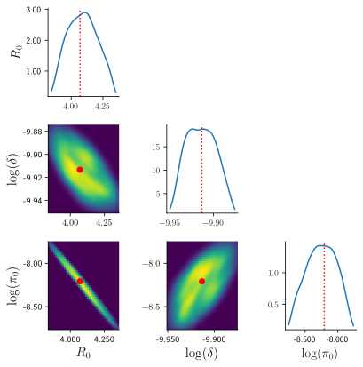
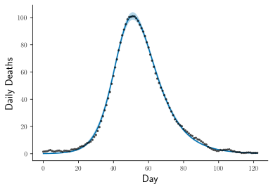
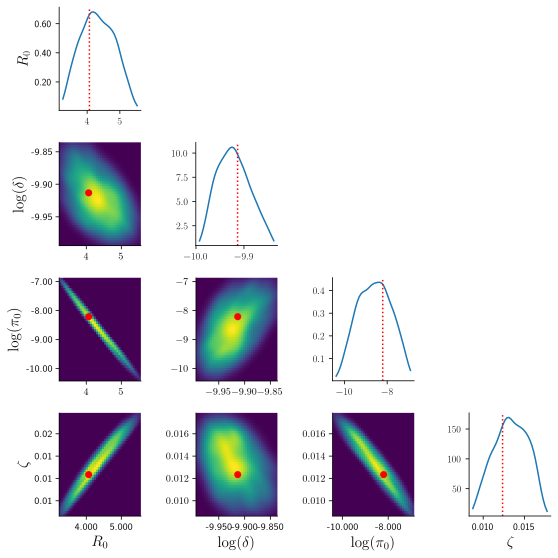
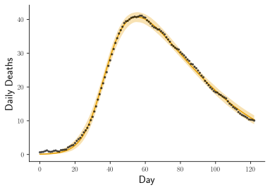

# epi-behavior-models

Source code for the paper:

**The paradox of neglecting changes in behavior: How standard epidemic models misestimate both transmissibility and final epidemic size**

Binod Pant, Marko Lalovic, István Z. Kiss, and Mauricio Santillana.  
*PLOS Computational Biology* **22**(9), e1014746 (2026).  
DOI: [10.1371/journal.pcbi.1014746](https://doi.org/10.1371/journal.pcbi.1014746)

Resources:

- [Paper](https://doi.org/10.1371/journal.pcbi.1014746)
- [Supplement (S1 Appendix)](https://doi.org/10.1371/journal.pcbi.1014746.s001)
- [Slides](https://zenodo.org/records/23593207)

## Overview
This repository provides a framework for parameter inference of compartmental epidemic models that incorporate human behavioral feedback. Inference uses approximate Bayesian computation with sequential Monte Carlo (ABC-SMC), implemented with the [pyABC](https://pyabc.readthedocs.io/en/latest/) library.

It includes:

- SEIRD models with constant transmission and behavioral feedback.
- ABC-SMC pipeline for estimating posterior distributions of epidemiological parameters.
- Bayesian model selection to compare behavioral and baseline models using Bayes factors.
- Analysis and diagnostics of inference results, with figures and tables generated in R.


## Examples

The examples below estimate parameters from synthetic observations for two models.

### 1. Baseline model (SEIRD)

Recover parameters under the assumption of constant transmission, $\beta(t) = \beta_0$:
```bash
python3 src/run_example.py --model baseline
```
| Estimated posterior (KDE) | Model fit to synthetic data |
| :---: | :---: |
|  |  |

The red dashed lines and markers indicate the ground-truth parameters used to generate the synthetic observations.

### 2. Behavioral model (Mixed form)

Recover parameters including the behavioral sensitivity $\zeta$:

```bash
python3 src/run_example.py --model behavior
```
| Estimated posterior (KDE) | Model fit to synthetic data |
| :---: | :---: |
|  |  |

The red dashed lines and markers indicate the ground-truth parameters used to generate the synthetic observations.

## Reproducing results
### 1. Installation

Clone the repository:
```bash
git clone https://github.com/markolalovic/epi-behavior-models.git
cd epi-behavior-models
```

Install the minimal set of Python packages in a fresh virtual environment:
```bash
python3 -m venv .venv
source .venv/bin/activate
python3 -m pip install --upgrade pip
python3 -m pip install -r requirements.txt
```

### 2. Data
The models are calibrated to COVID-19 mortality data from the Johns Hopkins University (JHU) CSSE repository:

- Source: [CSSEGISandData](https://github.com/CSSEGISandData/COVID-19/tree/master/csse_covid_19_data/csse_covid_19_time_series)
- Direct link: [`time_series_covid19_deaths_US.csv`](https://github.com/CSSEGISandData/COVID-19/blob/4360e50239b4eb6b22f3a1759323748f36752177/csse_covid_19_data/csse_covid_19_time_series/time_series_covid19_deaths_US.csv)
- File size: 11.9 MB

Note: `time_series_covid19_deaths_US.csv` is large and not tracked by version control, see `.gitignore`.

Download the CSV file and place it in `data/raw/` before execution.

### 3. Execution
To regenerate all results: processed data, summary statistics, figures and tables, run:
```bash
./run_all.sh --all
```

Note: full inference across 30 locations is computationally intensive.

See [`run_all.sh`](./run_all.sh) how to set flags to skip some parts, or use the provided summary statistics to regenerate tables and figures.

Note: Regenerating the figures and tables requires R (Version $\ge 4$) and the following R packages:
```R
install.packages(c(
    "ggplot2", "dplyr", "tidyr", "reticulate", "tikzDevice",
    "patchwork", "knitr", "kableExtra", "ggh4x"))
```
For example, install with:
```bash
Rscript -e 'install.packages(c("patchwork", "knitr", "kableExtra", "ggh4x"), repos = "https://cloud.r-project.org")'
```

## Citation
If you find this useful in your work, please cite the corresponding paper:

```bibtex
@article{pant2026paradox,
  title = {The paradox of neglecting changes in behavior: {How} standard epidemic models misestimate both transmissibility and final epidemic size},
  author = {Pant, Binod and Lalovic, Marko and Kiss, Istv{\'a}n Z. and Santillana, Mauricio},
  journal = {PLOS Computational Biology},
  volume = {22},
  number = {9},
  pages = {e1014746},
  year = {2026},
  doi = {10.1371/journal.pcbi.1014746},
  url = {https://doi.org/10.1371/journal.pcbi.1014746},
  publisher = {Public Library of Science}
}
```
